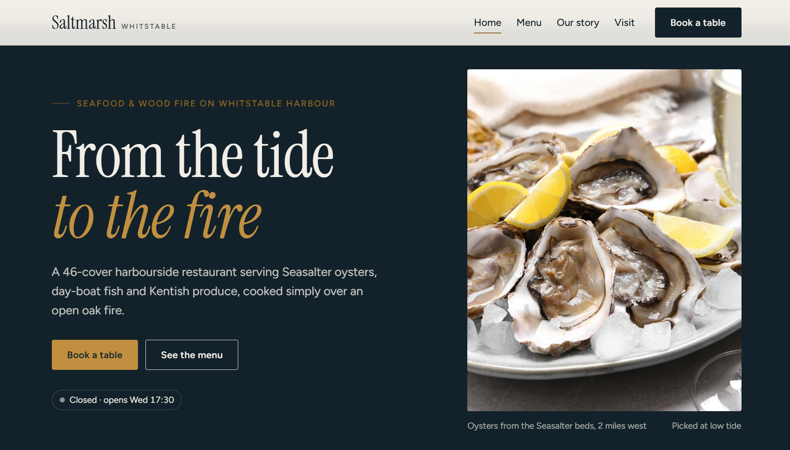

# Saltmarsh: Restaurant Website

A four-page website for **Saltmarsh**, a fictional seafood and wood-fire restaurant on Whitstable harbour. It's built with plain HTML, CSS and JavaScript, with no frameworks or libraries.

**Live demo:** _saltmarshwhitstable.netlify.app_
**Built by:** _Molly Hoy_



## Features

- **Responsive design** from 320px phones to wide desktops, using CSS Grid and Flexbox
- **Mobile navigation**: an animated hamburger menu with `aria-expanded`, closes on Escape
- **Live opening status**: shows "Open now · until 22:00" or "Closed · opens Wed 17:30", calculated in UK time
- **Filterable menu**: filter by course or dietary need (vegetarian, gluten-free, dairy-free), or search as you type, with a live result count and a "no results" state
- **Booking form with custom validation**:
  - Date picker limited to the next 60 days. It blocks closed days (Monday and Tuesday).
  - Time slots are generated from the opening hours. Times that have already passed today are removed.
  - Errors appear inline and are announced to screen readers. Focus moves to the first problem.
  - Confirmation summary built safely with `textContent` (no XSS)
- **Photo gallery lightbox**: keyboard arrows, Escape to close, focus trapping, and focus returns to the photo you opened
- **Accessibility**: semantic HTML, skip link, visible focus states, `aria-live` regions, `prefers-reduced-motion` support
- **Animations**: load-in hero, scroll-reveal sections (IntersectionObserver), hover effects

## Tech

HTML5 · CSS3 (custom properties, Grid, Flexbox, media queries) · vanilla JavaScript (ES6+)

## Project structure

```
saltmarsh/
├── index.html      Home
├── menu.html       Menu with filters
├── about.html      Story, suppliers, gallery
├── book.html       Booking form + hours
├── css/
│   └── styles.css  All styles, organised in numbered sections
├── js/
│   ├── main.js     Shared: nav, opening hours, placeholders, animations
│   ├── menu.js     Menu filtering
│   ├── about.js    Gallery lightbox
│   └── booking.js  Form validation + time slots
└── images/         Photos (see images/README.md)
```

## Running it locally

Open `index.html` in a browser. Or, in VS Code, install the **Live Server** extension, right-click `index.html` and choose "Open with Live Server".

## What I'd add next

- Connect the booking form to a real back end, such as Formspree or a small Node API
- Load the menu from a JSON file so the restaurant can update it without editing HTML
- Add a language toggle and structured data (Schema.org `Restaurant`) for SEO
